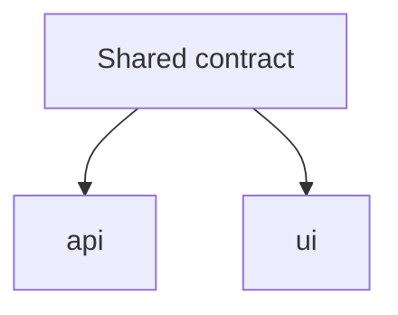

# Execution Plan — <goal>

<!-- status: draft | approved | running | merged
     Gate: `wf.py check-exec-plan <this file>` must print PASS before any agent starts. -->

## Task list
| Task | Workstream | Agent | DoD |
|---|---|---|---|

## Dependency graph


## File ownership
Each file belongs to exactly ONE agent. The coordinator owns no source files.

## Contract (API / schema / types) — defined BEFORE parallel work
- `shared/types/<x>.ts` — written and merged first

## Test responsibility
| Agent | Tests |
|---|---|

## Merge order
1. contract → 2. api → 3. ui

## Agent return format
Completed task · Changed files · Tests run · Results · Blockers · Items requiring human decision

```json
{
  "agents": [
    {"name": "coordinator", "role": "coordinator", "files": []},
    {"name": "api", "role": "worker", "worktree": "../wt-api", "tasks": ["TASK-000"], "files": ["src/api/x.ts"], "tests": ["src/api/x.test.ts"]},
    {"name": "ui", "role": "worker", "worktree": "../wt-ui", "tasks": ["TASK-000"], "files": ["src/ui/x.tsx"], "tests": ["src/ui/x.test.tsx"]}
  ],
  "contracts": ["shared/types/x.ts"],
  "merge_order": ["contract", "api", "ui"]
}
```
